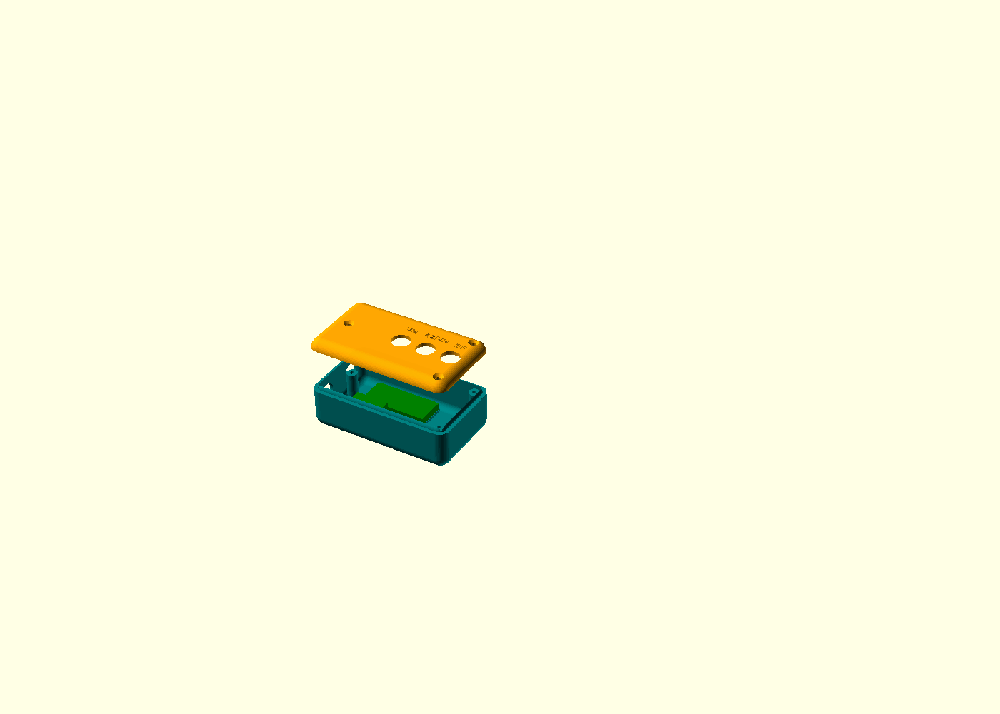

# Rotolight LED — barra estroboscópica para parabrisa (viatura descaracterizada)

Projeto modular de barra de luz de emergência com **144 LEDs em fita** (vermelho, azul, branco), presa ao **parafuso do quebra-sol** por braços ajustáveis, **removível sem ferramentas** e com **todas as peças imprimíveis na Bambu Lab A1** (256 × 256 × 256 mm).

Desenho **orgânico**: a frente de cada meia-barra acompanha a curvatura do para-brisa (raio medido no carro, parâmetro `R_vidro`), as arestas e pontas são arredondadas e as peças de fixação têm transições suaves.

Status: **v0.7 em andamento.** A barra virou **uma só, ao longo do topo do para-brisa** (passa acima do retrovisor), com **fita RGB endereçável WS2815 IP67** colada numa barra chata de alumínio 1" × 1/8" e presa por **dois trilhos impressos** e **duas tampas de ponta**. A **controladora** é uma caixa mínima (≈ 95 × 55 × 31 mm) com 3 botões: pisca vermelho, pisca metade azul / metade vermelho e branco fixo. Os braços e as docas saíram; o **suporte** é a próxima etapa. Nesta etapa o limite da mesa da impressora foi deixado de lado (trilho de 1100 mm). **Os docs 01–05 abaixo ainda descrevem a v0.6** e serão atualizados ao fechar a v0.7.



## Visão geral

```
 [quebra-sol E]                                               [quebra-sol D]
   doca ─ engate ─ braço telescópico ─ adaptador ═[ MEIA-BARRA E ]  (retrovisor)  [ MEIA-BARRA D ]═ adaptador ─ braço ─ engate ─ doca
                                           72 LEDs em fita          72 LEDs em fita
                                                 └── GX16-10 ─┐  ┌─ GX16-10 ──┘
                                                   cabos de 10 vias pelo forro/coluna A
                                                       [ CAIXA DE CONTROLE ] ── acendedor
                                                          (sob o painel)
```

| Módulo | Peças impressas | Função |
|---|---|---|
| **Meia-barra** (×2, espelhadas) | carcaça + junta TPU | 3 fileiras de fita de LED (VM, BR, AZ) atrás de janela de policarbonato; a tampa traseira de alumínio é também o dissipador |
| **Braço** (×2, iguais) | adaptador, braço corrediça, braço fixo, engate, 3 manoplas | Telescópico (passos de 10 mm) + 2 articulações verticais + junta rosácea tipo Hirth (inclinação em passos de 15°, LEDs na horizontal em 0°) |
| **Extensor** (opcional, empilhável) | extensor | Entra entre o braço fixo e a corrediça e alonga o braço em até 80 mm |
| **Doca** (×2, iguais) | doca + pino magnético | Fica no carro, presa pelos **dois** parafusos do suporte do quebra-sol; a barra encaixa e trava com um pino |
| **Controle** (×1, fica no carro) | caixa_controle + tampa_controle | Módulos prontos: Arduino Nano no adaptador de bornes, placa de 12 canais OPMSC12, buck 5 V, diodo ideal LTC4359, TVS 5KP16A, pulsador |

Os módulos se ligam entre si só por parafusos, pinos e encaixes: qualquer um pode ser trocado ou reimpresso sozinho, e a maior peça (a carcaça, 251 mm) cabe na mesa da A1.

## Estrutura

```
rotolight/
├── README.md                      ← este arquivo
├── docs/
│   ├── 01_pesquisa_componentes.md ← pesquisa, decisões, legislação, térmica, links
│   ├── 02_bom.md                  ← lista de materiais com faixas de custo
│   ├── 03_esquema_eletrico.md     ← esquema, mapa de canais, layout dos LEDs
│   ├── 04_instrucoes_montagem.md  ← impressão, montagem, instalação, testes
│   └── 05_lista_compras_eletronica.md ← eletrônicos com links da Shopee/AliExpress
├── cad/
│   ├── rotolight.scad             ← modelo paramétrico (todas as peças)
│   ├── exportar.sh                ← gera STL + 3MF e confere se cabe na A1
│   ├── exportados/*.3mf           ← peças prontas para o Bambu Studio
│   └── *.png                      ← vistas renderizadas
└── firmware/rotolight/rotolight.ino ← Arduino Nano: 8 padrões, 6 combinações de cor
```

## Gerar as peças

```bash
cd rotolight/cad
./exportar.sh            # requer openscad; a conferência usa python3 + trimesh
```

Parâmetros que dependem do carro (topo do `.scad`): `R_vidro`, `d_parafuso_quebra_sol`, `parafusos_doca`, `L_lingueta`, `L_fixo`, `L_corr`, `angulo_vidro`. Ver doc 04, seção 4.0.

## Números principais

| Item | Valor |
|---|---|
| LEDs | 144 em fita 12 V 2835 de 5 mm (48 VM + 48 AZ + 48 BR), trechos de 100 mm |
| Canais | 12 (4 zonas × 3 cores), ~1 W cada |
| Consumo | pico de ~0,35 A a 12 V (até ~0,6 A a 14,8 V) |
| Proteção | fusível 3 A, diodo ideal LTC4359, TVS 5KP16A, buck 5 V, redução térmica por NTC |
| Caixa de controle | 219 × 115 × 34 mm, separada, sob o painel |
| Meia-barra | 238 × 38 × 19 mm (C × A × P), sem contar o ressalto da junta; frente curva com flecha de ~2,4 mm (R = 3000 mm) |
| Peso | alumínio ≈ 160 g (calculado); **o peso das peças impressas sai do fatiador**: pesar o conjunto na Fase 3 (meta < 500 g) |

## Pendências e riscos conhecidos

1. **Legislação:** a Res. CONTRAN 970/2022 fala em vermelho e azul; o uso de **branco** precisa de validação institucional (doc 01, seção 1.0).
2. **Brilho da fita (v0.6):** ~1 W por canal, sem óptica. O **teste ao sol é eliminatório** (doc 04, seção 4.10). Se faltar brilho, trocar por fita de ≥ 14,4 W/m do mesmo tamanho.
3. **Térmica e resina:** a fita IP65 pode amarelar no calor do para-brisa. O firmware reduz o brilho pelo NTC; medir no teste ao sol.
4. **PETG a 80 °C:** está no limite. Versão final em ASA, se a A1 imprimir sem empenar.
5. **Módulos sem furação conhecida:** os anúncios não informam os furos. A caixa usa bolsos + VHB + abraçadeira; **medir as placas** e corrigir `modulos` no `.scad` antes de imprimir a caixa.
6. **Anúncios não verificados:** os links da Shopee e do AliExpress não puderam ser abertos deste ambiente (doc 05). Conferir variante, preço e ficha antes de comprar, principalmente a variante "PNP input / NPN output" da OPMSC12.
7. **Medidas do veículo** (parafusos do quebra-sol, airbag de cortina, caminho do cabo, lugar da caixa) ainda não conferidas num carro real.
8. Firmware testado **só em simulação no PC**; falta gravar e testar no Nano com a OPMSC12 (PWM de 250 Hz nos níveis 12,5 % e 31 %).
9. **Peso acima da meta:** a auditoria estimou ~570–700 g (barra + braços, sem cabo), contra a meta de 500 g. Decisão do usuário: aceitar por enquanto. A caixa, que saiu da barra, alivia o braço.
10. **Resistência da fixação:** braço reforçado na v0.6 (seções de pé, língua 16 × 11, abas de 10 mm). **Decisão:** imprimir em PETG e testar (vibração, buraco, queda); a peça que falhar troca de material (alumínio ou PETG-CF).
