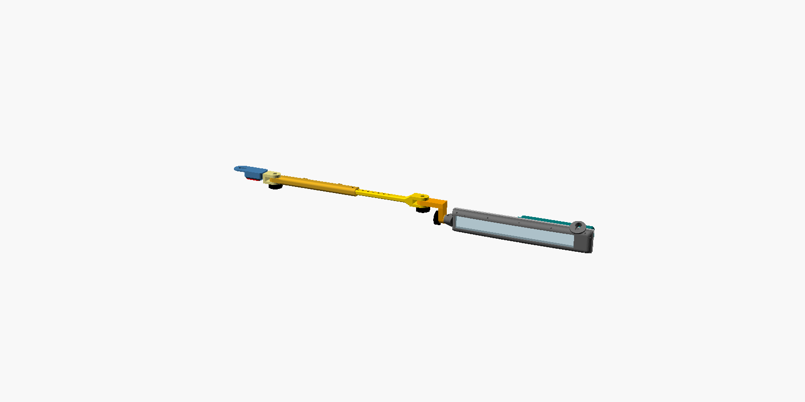

# Rotolight LED — barra estroboscópica para parabrisa (viatura descaracterizada)

Projeto modular de barra de luz de emergência com **72 LEDs** (vermelho, azul, branco), presa ao **parafuso do quebra-sol** por braços ajustáveis, **removível sem ferramentas** e com **todas as peças imprimíveis na Bambu Lab A1** (256 × 256 × 256 mm).

Desenho **orgânico**: a frente de cada meia-barra acompanha a curvatura do para-brisa (raio medido no carro, parâmetro `R_vidro`), as arestas e pontas são arredondadas e as peças de fixação têm transições suaves.

Status: **v0.4, projeto.** Nada foi fabricado nem testado em bancada. Falta desenhar as PCBs (KiCad) e fazer o teste térmico (ver "Pendências").



## Visão geral

```
 [quebra-sol E]                                               [quebra-sol D]
   doca ─ engate ─ braço telescópico ─ adaptador ═[ MEIA-BARRA E ]  (retrovisor)  [ MEIA-BARRA D ]═ adaptador ─ braço ─ engate ─ doca
                                          36 LEDs + caixa de controle     36 LEDs
```

| Módulo | Peças impressas | Função |
|---|---|---|
| **Meia-barra** (×2, espelhadas) | carcaça + junta TPU | 36 LEDs atrás de janela de policarbonato; a tampa traseira de alumínio é também o dissipador |
| **Braço** (×2, iguais) | adaptador, braço corrediça, braço fixo, engate, 3 manoplas | Telescópico (passos de 10 mm) + 2 articulações verticais + junta rosácea tipo Hirth (inclinação em passos de 15°, LEDs na horizontal em 0°) |
| **Extensor** (opcional, empilhável) | extensor | Entra entre o braço fixo e a corrediça e alonga o braço em até 80 mm |
| **Doca** (×2, iguais) | doca + pino magnético | Fica no carro, presa pelos **dois** parafusos do suporte do quebra-sol; a barra encaixa e trava com um pino |
| **Controle** (×1) | caixa + tampa | Arduino Nano, 12 canais MOSFET, proteção de entrada, pulsador |

Os módulos se ligam entre si só por parafusos, pinos e encaixes: qualquer um pode ser trocado ou reimpresso sozinho, e a maior peça (a carcaça, 251 mm) cabe na mesa da A1.

## Estrutura

```
rotolight/
├── README.md                      ← este arquivo
├── docs/
│   ├── 01_pesquisa_componentes.md ← pesquisa, decisões, legislação, térmica, links
│   ├── 02_bom.md                  ← lista de materiais com faixas de custo
│   ├── 03_esquema_eletrico.md     ← esquema, mapa de canais, layout dos LEDs
│   └── 04_instrucoes_montagem.md  ← impressão, montagem, instalação, testes
├── cad/
│   ├── rotolight.scad             ← modelo paramétrico (todas as peças)
│   ├── exportar.sh                ← gera STL + 3MF e confere se cabe na A1
│   ├── exportados/*.3mf           ← peças prontas para o Bambu Studio
│   └── *.png                      ← vistas renderizadas
└── firmware/rotolight/rotolight.ino ← Arduino Nano: 8 padrões, 6 combinações de cor
```

## Gerar as peças

```bash
cd rotolight/cad
./exportar.sh            # requer openscad; a conferência usa python3 + trimesh
```

Parâmetros que dependem do carro (topo do `.scad`): `R_vidro`, `d_parafuso_quebra_sol`, `parafusos_doca`, `L_lingueta`, `L_fixo`, `L_corr`, `angulo_vidro`. Ver doc 04, seção 4.0.

## Números principais

| Item | Valor |
|---|---|
| LEDs | 72 (24 VM + 24 AZ + 24 BR), 3535, 350 mA |
| Canais | 12 (4 zonas × 3 cores) |
| Consumo | pico de 2,8 A (≈ 40 W a 14,4 V); média de 8–15 W conforme o padrão |
| Proteção | fusível 5 A, TVS SMBJ18A, LDO automotivo, redução térmica por NTC |
| Meia-barra | 238 × 38 × 19 mm (C × A × P), sem contar o ressalto da junta; frente curva com flecha de ~2,4 mm (R = 3000 mm) |
| Peso | alumínio ≈ 160 g (calculado); **o peso das peças impressas sai do fatiador**: pesar o conjunto na Fase 3 (meta < 500 g) |

## Pendências e riscos conhecidos

1. **Legislação:** a Res. CONTRAN 970/2022 fala em vermelho e azul; o uso de **branco** precisa de validação institucional (doc 01, seção 1.0).
2. **Térmica:** a estimativa indica 95–115 °C no alumínio com a cabine a 70 °C em uso contínuo. O firmware reduz o brilho, mas o **teste ao sol é eliminatório** (doc 01, seção 1.6).
3. **PETG a 80 °C:** está no limite. Versão final em ASA, se a A1 imprimir sem empenar.
4. **PCBs ainda não desenhadas** (KiCad): placa de LEDs em alumínio e placa portadora do Nano.
5. **Medidas do veículo** (parafuso do quebra-sol, airbag de cortina, folga do forro) ainda não conferidas num carro real.
6. Firmware testado **só em simulação no PC** (lógica dos padrões e limite de corrente); falta gravar e testar no Nano.
7. **Peso acima da meta:** a auditoria estimou ~570 g no mínimo e ~700 g realista (barra + braços, sem cabo), contra a meta de 500 g. O alumínio sozinho pesa ~150 g. Baixar o peso pede uma decisão de projeto (ver relatório da avaliação).
8. **Resistência da fixação (decisão do usuário, v0.4):** a doca agora é **ancorada nos dois parafusos** do suporte do quebra-sol, que prendem a placa fina; o momento do braço vira um binário nos parafusos e a seção crítica passa a ser o corpo cheio da doca (~11 MPa a 5 g, estimado). Língua do engate e corrediça ficam acima de 45 MPa num pico de 5 g sem a ventosa. **Decisão:** imprimir tudo em PETG e testar (vibração, buraco, queda); a peça que falhar troca de material (alumínio ou PETG-CF). Peso: aceito acima de 500 g por enquanto. Material: PETG no protótipo, ASA na versão final.
